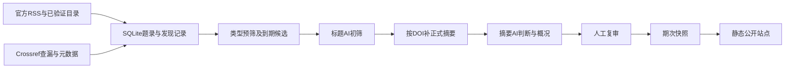

# LitBrief 架构复查与实施顺序

更新：2026-11-12。本文区分当前实现、已确认方向和待决定方案；不把规划写成已交付功能。

## 目标与约束

目标是让课题组以较少时间发现值得读的能源—环境—产业与社会系统研究。主要成本是人工复审、来源维护和模型处理，而非几千条题录本身。质量与来源时效都需要证据；“全部网页都能打开”不是唯一手段，接口返回200也不是完整覆盖证明。

不变约束：来源白名单、问题导向筛选、摘要依据透明、重要文献与相关列表分开、四天组期、前几期人工发布、期次快照稳定、低并发。会议探索仍不进入生产。Joule、The Innovation、EES 继续停用，不因提出月度机制自动恢复。

## 保留最小结构

一个Python项目、一个SQLite数据库、一个串行工作进程、一个本地审核界面、一个静态发布目录。服务器用systemd调度，浏览器只作人工辅助。保留当前原生HTML/CSS/JS，不引入React、Redis、消息队列、向量库、自治多agent或全天运行的桌面浏览器。

- `config/sources.json` 为运行来源注册表，文档解释选源依据；现有一致性检查继续防止名单漂移。
- 数据库是文章身份、状态、审核和期次的唯一编辑来源；原始响应是诊断证据，不能代替文章状态。
- 生产入口逐步归并为 `workflow.py`。`batch_screen.py` 是现有批量引擎；单篇与旧接口保留为明确标识的诊断入口，不让多个定时任务同时消费队列。
- 接口验证脚本是短期验收工具。某个接口通过授权和覆盖测试后，解析逻辑进入唯一摘要补全流程，不再追加一个长期独立补全任务。

## 真实实现中的问题与处置

| 观察 | 后果 | 本轮处置／下一步 |
|---|---|---|
| `ingest` 原来用“今天减14天”判断历史 | 晚到索引、月末筛选或补摘要可能移走应处理文章 | 已改为固定首次监测起点；新增回归检查。没有重分历史库。 |
| `enrich` 原只选 `not_attempted`，Europe PMC另有脚本 | 未索引记录在以后出现摘要也不会自然补回；补全历史分散 | 已统一到 `enrichment.py`；旧入口委托同一队列。临时失败/索引延迟最多3轮，拒绝和限流持久暂停提供方，身份/解析问题人工核对；不静默删文。 |
| 同一阶段存在批量、单篇、旧workflow入口 | 模型约束或状态口径可能分叉 | 日常只使用标题→摘要批量主流程；下一阶段统一调度，保留小样本诊断能力。 |
| 采集阶段仍复用最初核验模块和全窗口原始缓存 | 功能已跑通，但长期缓存与目录核对还不够清晰 | 先测真实源，再按出版社族提取已证明必要的适配器；不先重写27套抓取器。 |
| 当前 `build_issue` 收录未发表的已通过文章 | 支持迟到补录，但没有月度期次类型与月度归属 | 月度模式不能仅改timer；需增加期次类型、适用窗口和全站去重，迁移原有四天期次ID。 |
| 期刊Top标签不能保证主题匹配 | 工程、工艺、土壤文章被模型包装成系统意义 | 使用已确认硬边界与三个反例，排除结果保留抽检；未自动重跑所有历史文章。 |
| 公开导出与私有数据已分开 | 可以安全共享代码，不能把整目录变成网站根目录 | 继续只导出审核后的快照；GitHub只含代码、配置模板、文档与许可，不含outputs或.env。 |

## 出版社访问：先取得证据，再决定适配器

Pro核验报告主要结论采纳；它使用旧30刊范围，当前为27刊。Scopus可跨出版社补摘要，但有索引延迟和权限条件。Springer Meta支持摘要字段并不证明Nature13刊覆盖。Europe PMC现有代码已传`resultType=core`，本轮再查剩余3个DOI均返回200但无记录，不能归咎于默认lite。报告不证明任何账号、云服务器或第三方AI处理已获许可。

优先路线：

1. 保留已可用的官方RSS、Nature目录与精确DOI校验；Crossref做查漏补充，不成为出版社文章入库的前置条件。
2. 先把已有可用公开路径移出攻关范围，按[来源缺口清单](source-access.md)处理剩余刊。Scopus/ScienceDirect仅补已证实的缺口；Springer Meta对当前已有Nature公共路径增益待证，暂不购买Premium。
3. 公共来源只保留已经证明有增益的OpenAlex／Europe PMC。不要默认给每篇文章串联所有数据库和全文下载。
4. 用户选择保守部署：优先现有本地/校内环境采集和审核，外部网站仅托管已审静态文件。不追求校外服务器直接使用学校订阅，不以Institutional Token或VPN无人值守为前提。先手动/本地定时运行，再评估确有必要的校内常开节点。
5. 稳定发现入口仍须逐刊核对。摘要接口成功不能解决所有目录漏抓，跨库检索只能作为明确标注的延迟发现备选。

本轮新增 `publisher_probe.py`：单DOI、最多一次请求、不自动重试、不存摘要、不调用AI。支持Scopus／ScienceDirect／Springer和Europe PMC状态核验。已做离线解析、错误分类和密钥隔离测试；Elsevier已有key并实测被API认证/授权拒绝，直连对照未改善；Springer尚待申请。未宣称通过覆盖验收。账号检查、申请和命令见 [API申请与验证](publisher-api-access.md)。

授权是具体现实依赖：Elsevier当前ScienceDirect TDM条款对第三方处理/托管有明确要求，申请应把AI供应商、云服务器和公开中文分析一并说明。该条款不能直接泛化成所有出版商、所有开放摘要的统一法律结论。

## 月度方案：用户已同意机制，待实现分刊与组期

把发现频率、AI筛选频率、公开组期分开。仍定期低成本发现题录，保留原始在线日期；月底处理尚未筛选的月度候选。这样防止RSS滚动丢文，也无需每四天花人工审核低命中来源。

建议第一批只试 **Applied Energy、Building and Environment** 两刊；ESE、RSER先观察，确有低收益高负担时再转。RCR保持现有安排。用户已确认月度机制可行；上述两刊沿用首批实施建议，当前27刊周期配置未改变，月度生成器尚未实现。

月度标准：直接对应五个核心研究问题；主要结论能解释系统转型、政策、供应链或住房需求；相对已发文献有新增阅读价值。边缘关联、工程实现、工艺与局部性能提升仍排除，不把月度栏目当收容区。不设Top N，不凑数；月底没有合格文章就不生成空刊。

拟采用自然月归属、次月初处理前月新增；这是产品方案，未启动自动任务。已发文献全站唯一，月底不再重复收录四天刊。若需要“回顾本月重点”，仅链接已发内容，不重复AI分析。迟到补录记录真实发表日期与首次发现日期，进入下一可用期次并标注补录。会议按论文集公开变化处理，不强制每月产生内容。

月度节省主要来自少做无价值的复审与来源维护，不能保证同一批文章仅因月底批处理就减少总tokens。需记录每来源题录量、AI用量、推荐数、人工保留数与缺摘要数，先跑两轮观察；低收益则停用，不再添第三套周期。

实现时只增加必要字段：来源的筛选周期与严格策略、期次的四天/月度类型。继续同库、同审核页、同快照与静态模板。为跨月、迟到补录、同文去重、人工撤回建立有意义的回归检查。

## 实施顺序与停止扩张的条件

1. **本轮**：导航图标打磨；核验Pro报告；修复14天老化问题；提供API单篇测试；独立Git仓库和公开代码审查。
2. **接口授权后**：先用每出版社族一篇已知有摘要的论文测权限，再对13个Nature刊及其他启用刊各取“已知有摘要＋最新文章”样本测覆盖与滞后。有失败再扩大样本，避免先把81篇都跑一遍仍不知道是权限还是解析失败。
3. **当前已落地**：统一公共摘要补全和有限重试，提供方暂停跨重启保留，人工修订优先于在途网络结果。下一步在实际本地/校内采集节点连续两个四天周期对目录差集，分开报告发现覆盖、摘要可得、延迟及人工依赖；外部静态服务器无需取得出版社权限。不能核实的刊明确标为部分覆盖。
4. **月度名单确认后**：增加同库月度组期与更严格筛选，先两刊试验；不恢复已退出三刊、不整批新增会议。
5. **人工质量稳定后**：再讨论自动发布。部署不要求解决全网所有挑战，但必须明确每个启用来源的可运行入口、剩余缺口和补录机制，不能把失败标成零新增。

## 云端审查范围

目标仓库为 `yunKKang/LitBrief`。本地项目目录为 `C:/CODE/LitBrief`。运行时环境变量前缀与尚未部署的旧服务文件名可继续使用literaturehot，避免无意义的全量改名；目录与站点显示名统一LitBrief。

云端agent应从本文件、选刊规则和测试开始，只用虚构数据验证。不需要本地数据库、API密钥或机构会话；没有凭证不能以“接口未跑”判定接口代码已验证。审查重点是阶段边界、异常状态、迟到文章、去重、发布隔离和成本限制。公开GitHub不等于部署公开文献站点。
