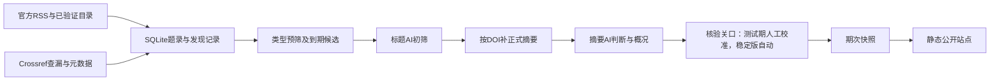

# LitBrief 架构复查与实施顺序

更新：2026-11-12。本文区分当前实现、已确认方向和待决定方案；不把规划写成已交付功能。

## 目标与约束

目标是让课题组以较少时间发现值得读的能源—环境—产业与社会系统研究。主要成本是人工复审、来源维护和模型处理，而非几千条题录本身。质量与来源时效都需要证据；“全部网页都能打开”不是唯一手段，接口返回200也不是完整覆盖证明。

不变约束：来源白名单、问题导向筛选、摘要依据透明、重要文献与相关列表分开、周刊组期、测试期校准、期次快照稳定、低并发。最终必须由agent闭环自动运行，用户主要对最终筛选结果反馈，不承担持续初筛、逐篇复审或抽检任务。会议探索仍不进入生产。Joule、The Innovation、EES 继续停用，不因提出月度机制自动恢复。

## 保留最小结构

一个Python项目、一个SQLite数据库、一个串行工作进程、一个本地审核界面、一个静态发布目录。默认本地／校内处理，外部服务器只托管审核后的静态文件；systemd仅为获准校内Linux节点预留，浏览器只作人工辅助。保留当前原生HTML/CSS/JS，不引入React、Redis、消息队列、向量库、自治多agent或全天运行的桌面浏览器。

- `config/sources.json` 为运行来源注册表，文档解释选源依据；现有一致性检查继续防止名单漂移。
- 数据库是文章身份、状态、审核和期次的唯一编辑来源；原始响应是诊断证据，不能代替文章状态。
- 生产入口逐步归并为 `workflow.py`。`batch_screen.py` 是现有批量引擎；单篇与旧接口保留为明确标识的诊断入口，不让多个定时任务同时消费队列。
- 接口验证脚本是短期验收工具。某个接口通过授权和覆盖测试后，解析逻辑进入唯一摘要补全流程，不再追加一个长期独立补全任务。

## 真实实现中的问题与处置

| 观察 | 后果 | 本轮处置／下一步 |
|---|---|---|
| `ingest` 原来用“今天减14天”判断历史 | 晚到索引、月末筛选或补摘要可能移走应处理文章 | 已改为固定首次监测起点；新增回归检查。没有重分历史库。 |
| `enrich` 原只选 `not_attempted`，Europe PMC另有脚本 | 未索引记录在以后出现摘要也不会自然补回；补全历史分散 | 已统一到 `enrichment.py`；旧入口委托同一队列。临时失败/索引延迟最多3轮，拒绝和限流持久暂停提供方，身份/解析问题人工核对；不静默删文。 |
| 同一阶段存在批量、单篇、旧workflow入口 | 模型约束或状态口径可能分叉 | 日常只使用标题→摘要批量主流程；下一阶段统一调度，保留小样本诊断能力。 |
| 采集阶段仍复用最初核验模块和全窗口原始缓存 | 功能已跑通，但长期缓存与目录核对还不够清晰 | 先测真实源，再按出版社族提取已证明必要的适配器；不先重写27套抓取器。 |
| 当前 `build_issue` 收录未发表的已通过文章 | 支持迟到补录，但没有月度期次类型与月度归属 | 月度模式不能仅改timer；需增加期次类型、适用窗口和全站去重，保留既有试运行期次ID。 |
| 期刊Top标签不能保证主题匹配 | 工程、工艺、土壤文章被模型包装成系统意义 | 使用已确认硬边界与三个反例，排除结果保留抽检；未自动重跑所有历史文章。 |
| 公开导出与私有数据已分开 | 可以安全共享代码，不能把整目录变成网站根目录 | 继续只导出审核后的快照；GitHub只含代码、配置模板、文档与许可，不含outputs或.env。 |

## 出版社访问：先取得证据，再决定适配器

Pro核验报告主要结论采纳；它使用旧30刊范围，当前为27刊。Scopus可跨出版社补摘要，但有索引延迟和权限条件。Springer Meta支持摘要字段并不证明Nature13刊覆盖。Europe PMC现有代码已传`resultType=core`，本轮再查剩余3个DOI均返回200但无记录，不能归咎于默认lite。报告不证明任何账号、云服务器或第三方AI处理已获许可。

优先路线：

1. 保留已可用的官方RSS、Nature目录与精确DOI校验；Crossref做查漏补充，不成为出版社文章入库的前置条件。
2. 先把已有可用公开路径移出攻关范围，按[来源缺口清单](source-access.md)处理剩余刊。Scopus/ScienceDirect仅补已证实的缺口；Springer Meta对当前已有Nature公共路径增益待证，暂不购买Premium。
3. 公共来源只保留已经证明有增益的OpenAlex／Europe PMC。不要默认给每篇文章串联所有数据库和全文下载。
4. 用户选择保守部署：优先现有本地/校内环境采集和审核，外部网站仅托管已审静态文件。不追求校外服务器直接使用学校订阅，不以Institutional Token或VPN无人值守为前提。先手动/本地定时运行，再评估确有必要的校内常开节点。
5. 稳定发现入口仍须逐刊核对。摘要接口成功不能解决所有目录漏抓，跨库检索只能作为明确标注的延迟发现备选。

本轮新增 `publisher_probe.py`：单DOI、最多一次请求、不自动重试、不存摘要、不调用AI。支持Scopus／ScienceDirect／Springer和Europe PMC状态核验。已做离线解析、错误分类和密钥隔离测试；Elsevier已有key并实测被API认证/授权拒绝，直连对照未改善；Springer尚待申请。未宣称通过覆盖验收。账号检查、申请和命令见 [API申请与验证](publisher-api-access.md)。

授权是具体现实依赖：Elsevier当前ScienceDirect TDM条款对第三方处理/托管有明确要求，申请应把AI供应商、云服务器和公开中文分析一并说明。该条款不能直接泛化成所有出版商、所有开放摘要的统一法律结论。

## 月度方案：用户已同意机制，待实现分刊与组期

把发现频率、AI筛选频率、公开组期分开。仍定期低成本发现题录，保留原始在线日期；月底处理尚未筛选的月度候选。这样防止RSS滚动丢文，也无需每周处理低命中来源。

建议第一批只试 **Applied Energy、Building and Environment** 两刊；ESE、RSER先观察，确有低收益高负担时再转。RCR保持现有安排。用户已确认月度机制可行；上述两刊沿用首批实施建议，当前27刊周期配置未改变，月度生成器尚未实现。

月度标准：直接对应五个核心研究问题；主要结论能解释系统转型、政策、供应链或住房需求；相对已发文献有新增阅读价值。边缘关联、工程实现、工艺与局部性能提升仍排除，不把月度栏目当收容区。不设Top N，不凑数；月底没有合格文章就不生成空刊。

拟采用自然月归属、次月初处理前月新增；这是产品方案，未启动自动任务。已发文献全站唯一，月底不再重复收录周刊。若需要“回顾本月重点”，仅链接已发内容，不重复AI分析。迟到补录记录真实发表日期与首次发现日期，进入下一可用期次并标注补录。会议按论文集公开变化处理，不强制每月产生内容。

月度节省主要来自少做无价值的复审与来源维护，不能保证同一批文章仅因月底批处理就减少总tokens。需记录每来源题录量、AI用量、推荐数、人工保留数与缺摘要数，先跑两轮观察；低收益则停用，不再添第三套周期。

实现时只增加必要字段：来源的筛选周期与严格策略、期次的周刊/月度类型。继续同库、同审核页、同快照与静态模板。为跨月、迟到补录、同文去重、人工撤回建立有意义的回归检查。

## 下一阶段规划：吸收外部审查后的顺序（2026-11-12）

用户进一步明确：测试期可复核少量最终候选，最终整个loop由agent管理。下文涉及人工的动作仅指测试校准、用户主动反馈或无法自动处置的运维例外；不能把初始筛选或持续人工标注作为正常运行前提。

本节取代此前按接口接通顺序安排的实施列表。外部《LitBrief 项目审查与优化路线图》只取得README与部分结构，其风险清单不等于已经确认的漏洞。规划核查以提交 `c5bd41a6e74c02484a81b1ebacb7870a1255c2f5` 为基线，72项测试通过，另用临时库复现三个缺口。随后工作包A已经实现；下节问题描述保留核查时证据，当前修复状态以A为准。期刊配置和模型提示词未放宽。

### 对审查建议的取舍

| 建议 | 核对后的判断 | 采用方式 |
|---|---|---|
| 防止标题误排、增加排除抽检 | 已有标题保守排除规则和AI／类型排除列表；尚无可复现抽样、结构化人工标签与版本比较 | 优先完善现有入口，不另建审核平台；沿用工程／工艺等明确边界，不能以“潜在方法借鉴”普遍放宽范围 |
| 建立100–150篇标注集 | 是建议规模，并非质量门槛；一次标注会增加当前负担 | 优先复用已有反馈，测试期少量最终候选校准；30–50篇仅为逐步积累的参考规模，不给用户下达标注配额、不作上线硬门槛。agent抽检与人类反馈必须分开标记 |
| 中英文证据卡与研究用途 | 审核页已有摘要、引文和中文概况并列；逐字引文检查不能证明语义一致 | 先强化数字、条件、对象和结论边界核验。公开仍为短概况；方法等摘要未述则留空／明确未述，研究用途为可选内部判断 |
| 完整性与故障可见 | 已有逐刊数量、首页诊断和统一补全；首页可达性不能说明目录覆盖 | 复用来源页补最近成功发现、可核对窗口、待补时长与提供方暂停；无对照时只写部分覆盖／未知 |
| 单实例、限流、静态隔离 | 已有进程锁、串行调用、有限补全、CSRF／Host检查和公开字段白名单 | 保留并补缺失的中断及恢复场景，避免重建任务系统；token阈值仍是请求间停止阈值，不承诺硬金额上限 |
| 许可进入配置 | 方向有用，但同刊不同获取途径可能有不同限制 | 按摘要获取途径记录用途依据、核实日期与未决限制；不用单个“期刊已授权”布尔值概括 |
| 月度新增认识、全文比较、撤稿监测 | 与当前低频来源月度筛选不同，收益尚待证实 | 月度筛选继续推进；跨论文综合、全文比较和发表后监测后置，首版不增加额外AI批次 |
| SQLite版本风险 | 当前本地Python 3.14.0、SQLite 3.50.4，代码启用WAL；未核对具体公告适用版本及发行版补丁 | 实际处理节点上线前核对官方公告、补丁和备份恢复。此记录不能作为已确认漏洞或安全版本结论；静态网站服务器不运行本项目SQLite |

### 已确认的问题与已有保护

1. **人工排除可被材料更新重置（优先修复）**：`library.ingest` 在未发布文章的标题、摘要、类型或摘要来源变化时统一重置state/result；临时库中 `review(reject)` 后更新摘要，state从 `rejected` 变为 `pending`，审核历史仍在但当前决定失效。批处理本身不主动选择 `rejected`，问题入口在重新入库，不能只修改批处理查询。
2. **公开导出尚无整站提交边界（上线前修复）**：`webapp.export_site` 逐文件原子写入；`/publish` 先提交数据库发布状态再导出。注入导出异常后，旧首页未变而新文章页已出现，数据库新期次仍为published。部署文档要求独立release切换，但本地导出尚未落实同一原则。此实验未涉及线上站点。
3. **精确引文并不验证概况语义（审核缺口）**：虚构摘要只说“情景假设下强度可能降低”，配有完全一致引文的“实证全球总量下降”概况仍能通过 `parse_response`。这是现有格式／引文校验的能力边界，不能由此认定实际11篇待审概况都有失真。
4. **已有保护继续保留**：DOI／URL身份归并、期次内外去重、已发布快照不被材料更新覆盖、未批准材料不导出、原始摘要和人工备注不公开、错误模型文章ID拒收、停用来源不自动处理、付费失败不自动重试，均已有实现及对应测试。
5. **恢复链仍待补证据**：批量模型已有输入指纹、原始响应和用量日志，但缺少统一的请求级恢复记录及崩溃窗口测试。尤其“收到响应但落库前退出”“只留下未验证response缓存”“客户端超时计费未知”要在人工重排前可辨认；不能把所有情况都视作可再次付费。

### 工作包A：保护人工决定与发布／恢复边界

本阶段已完成首版：人工决定独立字段、材料变化留档和待复审、不可变release与成功指针、批处理请求账本与离线恢复、合成SQLite备份恢复。候选库与发布内容保持同一真源，未付费重跑历史AI。以下条目为已实现边界及验收要求；2026-11-12 已完成静态站点远端部署，自动调度仍未启用。

- **人工决定独立保护**：仍用同一SQLite，复用reviews历史，只增加必要的当前决定／待复核标志。材料更新保留人工排除并提示材料变化；人工通过后材料变化暂停组期，重新核验，不沿用旧摘要结论；已发布快照不改。只有显式人工操作才能撤销原人工决定并重新排队。记录修改前后的材料与模型版本关联。
- **可恢复导出**：导出到独立的新release目录，完整生成并校验后标为可部署；不在正在阅读的目录内逐文件替换。期次内容确认与导出成功状态分开记录，失败明确可见且可重导出。Windows本地不依赖管理员符号链接；Linux托管端按已有方案原子切换current，失败保留旧release，不自动清理旧版。
- **最小恢复信息**：单个请求记录输入指纹、发送前状态、响应保存位置、验证／入库状态及用量是否已知；有效缓存优先离线恢复，超时或未知费用要求人工核对。保留串行，不增任务队列或第二模型。
- **备份演练**：在隔离目录恢复含人工排除、待审、草稿、已发布和暂停记录的合成数据库，核对身份、状态、期次与重新导出的公开内容；真实库仍用一致性backup，不直接复制活动WAL文件。

验收：材料更新与并发回写不撤销人工排除；更改已批准材料阻止旧稿发布；中断导出不改变当前完整站点；重复恢复不新增付费调用、重复条目或重复期次；备份能还原编辑和发布状态。新增测试应先在当前实现上复现缺口，再随修复通过。

本轮验证：82项离线测试通过，覆盖超时不重试、旧原始响应缓存复用、响应落盘后中断恢复、并发人工排除优先、迁移旧库、备份完整性及同一发布内容重建。真实本地库先生成一致性备份后升级，队列数量不变、3条人工排除保留、integrity_check为ok；无付费模型调用、无真实文章新发布。测试期的人工入口仍在，自动核验／调度由工作包E交付。

### 工作包B：少量排除抽检与概况校准

首版已实现：分层可复现抽样、随机／定向标识、版本化样本、不改动原筛选决定的agent复核、逐字摘要证据约束、预算内串行调用与恢复、可选最终反馈及本地报告页。真实验收共两次调用8,459 tokens，未批准或发布文献。单独运行核验不会直接回写筛选决定；规则版本差异评估与疑似误排受控回流仍属于后续工作；自动发布准入的本地实现见E。后续自动调度调用相同入口，不把人工点击作为正常运行前提。

A中人工决定保护完成后开始；抽样和核验界面可以与A的恢复测试并行开发，但不提前放宽生产规则。

- 在现有排除列表增加可复现的抽检批次，记录抽样时间、候选集合、随机种子、筛选阶段和规则／模型版本。按标题排除、摘要排除、类型排除分层；期刊／研究方向作为覆盖检查，不必把全部组合都做成独立统计层。
- 稳定版由agent在预算内起步抽检约10–15篇随机排除项，另加最多5篇定向难例；按实际收益与tokens调整，不要求用户参与初筛。测试期用户主要复核最终候选，并可自愿查看少量系统提出的边界例。定向样本单独报告，不能混入随机样本计算总体误排率。
- 用户反馈与agent复核标签分开存储，不能把agent自评当成人工真值。相关性标签区分“明确无关／相关／材料不足”；阅读优先级、重复或增量不足另记原因，避免把“本期不读”固化成学科排除。缺摘要的疑似误排只记待核，不算确认误排。
- 逐步复用／积累有实际人工反馈的案例，留出固定验证子集；30–50篇仅供后续规模参考，不要求用户先标完；用户已否定的三个工程／土壤／工艺反例可作校准集，不能再假装未见测试样本。测试集不用于反复改提示词；历史公开资料、摘要和私人标注留本地，GitHub仅保留虚构回归样例。
- 比较新旧规则时先使用现有缓存和人工判断；确需模型重跑，仅处理固定小集，显式给token阈值、串行运行，不触发全库重筛。输出保留→排除、排除→保留、材料不足变化、token和新增人工负担；模型不自行修改生产边界。
- 审核概况重点核对：模拟／实绩、相关／因果、强度／总量、区域／全球、核算边界、数字和不确定性。保留英文支持片段与中文概况对照；方法和研究用途只在摘要足够时填写，推断与事实分开。先通过提示规范、确定性检查、最终候选的预算内语义核验和案例测试改进；稳定版不要求人工核验每篇，不默认引入第二家模型或多agent投票。

验收：抽样可重现，排除记录可追到阶段和输入版本，人工纠正不会被后续采集覆盖，规则对比不写回生产决定。报告展示分母与未知项；小样本只描述观察到的误排，不能声称全领域召回率或给出未经验证的质量达标百分比。新规则若误排固定的明确相关样本，先人工解释和处理差异再推广。

### 工作包C：来源缺口可见与两个周刊周期验证

与B结合日常试运行，不等待所有出版社API通过。

- 复用来源页和已有采集记录，分别展示成功请求时间、成功发现时间、实际核对窗口、待补摘要数量／最长等待、具体提供方暂停及最后证据时间。HTTP200、RSS条数与完整覆盖分别显示。
- 按实际采集节点连续观察两个周刊周期。能取得可信出版社目录的按DOI／PII做差集；只有滚动RSS或延迟数据库的标为部分覆盖；没有可核验对照的为未知，不制造覆盖率。
- 补充材料按已有有限重试处理，类型、日期和许可待核分别可见。无论文、无相关论文、未取得目录、尚未筛选不能共用“0新增”。
- 保留发表日、首次发现日、期次发布时间；补录文章进入下一可用期次并显式标识，不修改已发布快照。来源许可记录按获取途径维护，未决接口不自动投入模型处理。
- Nature保持现有公共路径；ES&T观察新RSS；ScienceDirect只查明确相关研究的剩余缺口和现有权益，不购买接口、迁移全部来源或重复挑战请求来追求表面全覆盖。

验收：每刊能解释本期处理到了哪一步，抽检结果与获取缺口分开呈现；给出覆盖证据和人工补录负担，不把易获取来源的推荐比例解释成研究活跃程度。两周期样本不足时继续观察，不推算全年收益。

### 工作包D：落地已同意的月度筛选

A与B的最小版本可用后推进；C的跨周期观察期间可实现，不必等全部出版社问题解决。

先按现有建议试Applied Energy、Building and Environment，两刊的周期切换是明确的功能发布，不能夹在采集重构中悄悄生效。名单与展示层级不扩大，RCR等维持现有安排，Joule、The Innovation、EES不恢复。

仍每天低成本发现，次月初集中筛选前月新增，采用更严格的直接系统关联与新增阅读价值要求。一个库、一套审核和静态模板；新增必要的来源筛选周期与期次类型，周刊／月刊全站去重。不凑数，不把月刊当边缘文章收容区；无合格文献不生成空刊。首版只组织审核过的文章，不叠加跨文献“月度新增认识”生成任务。

验收覆盖跨月／跨年、月度候选等待超过14天、迟到补录、两种期次不重复发布、草稿撤回及来源周期调整不重写已发快照。月度不自动减少同一批材料的模型tokens，收益要看人工时间、命中和每篇最终保留文献的实际用量。

### 工作包E：自动运行闭环（明确交付目标）

本地首版已实现并以合成数据走通：`workflow.py run-cycle` 默认离线影子检查，`--live` 显式网络处理，`--publish`另受publication_mode=automatic限制。真实配置仍manual。2026-11-12 已连接生产服务器并上线静态站点，未安装处理定时器。自动准入会校验筛选规则版本／输入材料／调用记录和当前概况核验，兼容已有有效人工批准；批准主体明确区分agent和human。各阶段共用串行锁与一轮token阈值，单源失败继续、未知计费停止本轮后续付费；到期窗口组期去重与跨期导出恢复已测试。

A提供状态与故障边界，B提供校准和核验，C提供缺口说明，D提供周期；在此基础上交付独立调度入口，串行执行发现→类型预筛→标题筛选→按需补摘要→摘要判断／最终候选语义核验→组期→完整导出→受控部署。运行依赖Python调度和模型接口，不依赖桌面Codex、持续浏览器登录或人工按钮；沿用现有单模型，不默认搭建多agent平台。

- 稳定版用户只需查看最终简报，并可反馈不相关、结论不当或值得多关注的方向。用户明确排除优先于后续agent决定，规则调整保留版本和回归证据；新增研究边界仍不能由模型自行扩大。
- 自动核验通过才准入期次，记录审核主体为system／agent，不能冒标human_reviewed；测试期用户确认单独留来源。此区别已实现并测试；现有review函数仍为人工入口，agent走独立准入函数。
- 排除抽样与最终概况核验由系统在明确调用预算内执行；对明确相关的恢复候选走统一材料／筛选流程，不每篇都额外调用多个模型。系统自检不能宣称已获得独立人工准确率。
- 单刊受限、单篇缺摘要／证据冲突按已有策略延后或隔离，不阻塞其余合格文章。该期附覆盖缺口与待处理状态；不通过放宽质量门槛或隐藏失败来保证有内容。
- 现有本地恢复CLI供测试与运维使用；run-cycle已优先离线恢复已保存响应。未知计费按配置暂停受影响请求，继续处理可独立推进的任务，不盲目付费重试。账号权限、预算变更等少数无法自助解决的运维问题集中提示用户，与日常论文筛选分开。
- 先以影子模式验证自动结果和既有反馈，再启用完整自动发布。启用前只需确定运行节点、发布凭证、单轮／周期预算及异常通知方式；不要求用户每期点击批准。不在这次状态修复中切换publication_mode。

验收：正常一期从发现到公开不需要人工操作；重启可恢复；单篇失败不阻塞整期；未核验材料不得公开；用户反馈可追溯且不会被自动覆盖。自动部署在实际服务器上单独验证，不用本地导出成功代替远端发布成功。

### 发布门槛与停止扩张

- A的状态／恢复检查通过；B完成已有反馈回归与少量最终候选校准；C能明确逐刊覆盖边界和补录办法；D实现后才在站点宣称支持月刊。
- 首期7篇已经用户复审通过，并按用户的部署授权于2026-11-12上线 `litbrief.sustainable-systems.world`，页面标注提前上线的试运行期次。外部服务器只接收已审静态release，不部署采集或审核后台。
- 接口授权、连续两周期观察与用户自愿提供的最终结果反馈属于真实证据，不能用单次单测替代。自动闭环是必交付目标；测试期手动模式只作临时校准，不因本次底层修复立即启用真实自动发布。
- 不加向量库、知识图谱、多agent投票、第二模型、微服务、多用户登录或全库全文抓取。论文更正／撤稿监测以后仅限已发布与人工收藏DOI，待归档与更新提示机制成熟再做。
- 主要观察人工复审耗时、随机抽检发现的疑似／确认误排、概况需实质改写的数量、各来源最终保留与token／补录成本；不以抓取量或AI排除率作为成功指标。

## 云端审查范围

目标仓库为 `yunKKang/LitBrief`。本地项目目录为 `C:/CODE/LitBrief`。运行时环境变量前缀与尚未部署的旧服务文件名可继续使用literaturehot，避免无意义的全量改名；目录与站点显示名统一LitBrief。

云端agent应从本文件、选刊规则和测试开始，只用虚构数据验证。不需要本地数据库、API密钥或机构会话；没有凭证不能以“接口未跑”判定接口代码已验证。审查重点是阶段边界、异常状态、迟到文章、去重、发布隔离和成本限制。公开GitHub不等于部署公开文献站点。

本轮验证补记：109项离线测试通过，真实库备份后只做影子检查，识别7条已有人工批准、0 tokens，候选状态及版本未变。远端自动部署、实际常开调度、两周期覆盖观察、月度期次与疑似误排受控回流仍未完成；本地流程跑通不能替代这些验收。

## 阅读与运维边界、数据保留待办（2026-11-12）

正式静态导出不带工作台导航或后台数据；当前 `/reading` 是带工作台入口的内部预览。按既定方案，公开服务器仅托管release，本地／校内处理节点保留私有数据库和后台。个人工作台应收敛到最终简报、可选反馈、确需关注的异常；用量明细、排除池、请求状态和长说明默认折叠到运行详情，本轮已完成首版：本地首页直接阅读，管理导航、筛选细目、证据／编辑、逐刊明细、用量与日志默认折叠；反馈保持可见。

用户担心排除内容无限积累。已有10 GiB占用提醒；本轮新增清理预览、明确确认后的执行器与保留规则，尚未接入自动删除调度。只读测量：outputs约403.7 MiB，数据库约35.7 MiB，备份约282.4 MiB；该快照不能用作未来增长率预测。

本轮已实现以下保留窗口和清单机制；真实清单暂无到期对象，尚未删除现有数据：

- 已发布简报、题录和用户关键反馈长期保留；不因清理旧站点构建版本删除往期内容。
- 已排除文章的摘要、详细模型输出和原始响应保留90天后精简；保留DOI／身份键、题名、期刊、时间、排除原因、规则版本与人工排除标志，以免再次抓取后重复付费或丢失用户决定。
- 普通抓取缓存、临时诊断文件保留30天；未解决调用、正在补材料的记录及需要保留的校准证据不随到期清理。
- 数据库备份保留最近7天全部恢复点，并轮转7个日备份与4个周备份；公开完整release保留当前及前2版。最新release本身包含完整往期归档，旧release只是旧构建副本。
- 摘要和材料还存在观察记录、请求输入、核验快照等副本；清理必须覆盖同一材料的相关副本，并按备份轮转逐步到期，不能只清空主表字段。保留必要证据与去重标记，不能破坏恢复和人工反馈保护。
- 在实际删除前生成具体文件／记录清单、保留例外与预计空间，确认对象后执行；本轮已生成真实清理预览，执行器只在临时数据上测试，没有删除现有数据。

执行边界：清单绑定数据库绝对路径、数据库内容摘要、规则与每个文件的校验值，24小时过期，变化后重新预览。人工标注、抽检、期次和未解决调用保护优先；共用证据、未归属旧AI缓存或旧文件副本会阻止数据库精简。精简前备份，保留去重／排除标记，观察及请求副本同步处理；文件删除部分失败可重新规划。当前不自动VACUUM、不递归删除目录、不接入定时清理。

## 公开部署进展（2026-11-12）

独立静态站点已上线，沿用课题组Nginx，使用 `/var/www/litbrief`、独立虚拟主机、证书、日志与ACME目录。公开页没有工作台。主站135个文件、链接目标、配置与原证书均通过前后校验。`deploy_static.py` 默认离线核验，`--activate` 才上传已确认的完整release；服务器验证公开文件白名单与SHA-256后原子切换，支持校验后回滚。129项本地测试通过，Linux隔离测试验证损坏上传不影响当前版、回滚及重复部署。证书模拟续期通过。

尚待实现与验收：常开处理节点的独立调度和自动上传联调、两周期来源覆盖、月度期次和疑似误排回流。publication_mode保持manual，本轮无新AI调用。下一阶段围绕这条既有单进程链路继续，不把采集、密钥或数据库搬到公开服务器。运维入口和限制见 [部署说明](../deploy/README.md)。

## 周刊、归档和历史回测调整（2026-11-12）

用户确认周日至周六为一周，周日执行、争取周日晚发布。配置改为7天、周日锚点；首期2026-11-11至14日试运行快照保留。公开选文标准只留主题和来源，细则留在内部规则；归档仅列期次入口，支持月份和日期筛选，不展开文章。

回测选择完整2026年10月，暂仅授权小批量成本测量，整月预算待实际tokens后确定。五个自然周窗口分别是9月27日至10月3日、10月4–10日、11–17日、18–24日、25–31日，首窗口只处理10月1–3日并标注覆盖范围。旧库1937条10月记录集中在月中后，前两个窗口仅0、5条，不当作完整月覆盖。先补来源与日期证据，再按周窗口排队；明确限制IDs，空样本不能退化为全库调用。测试结果继续留在私有历史队列，不自动改成人工通过或公开发表。

月刊仍按两本观察来源（Applied Energy、Building and Environment）严格筛选补充，周刊已发论文全站去重，不再次付费分析。真实月刊生成器、跨周期归属、历史分期准入、缺材料标记与覆盖报告都要完成后再出10月月刊。不能把四周已发文献直接拼接当作月刊验收。

执行节点沿用本地／校内，公网仅存静态release。日常发现、周日完整流程、成功后上传分开调度但共用锁与请求账本；模型串行、fast关闭、不确定计费不重试。受限的专用SSH发布凭证、常开节点、预算和异常通知渠道确认后才启用无人值守。详见部署文档的运行规划。

成本小样实测：24篇标题初筛2次请求7899 tokens，3篇摘要筛选1次请求4103 tokens，共12002 tokens；全程gpt-6-luna/high/default、串行。1篇留在私有历史推荐队列，尚未核验或发布。样本按期刊分层，不能将其保留率直接外推整月；语义核验与月度严格筛选成本未计入。真实明细保存在被忽略的outputs/backtest-202610，整月预算尚未确定。

周刊迁移验收：131项离线测试通过，包括跨月跨年、首次周刊与保留试运行快照同截止日时的首页排序、迟到顺延和空ID样本不触发付费调用。真实首期快照内容保持不变。
